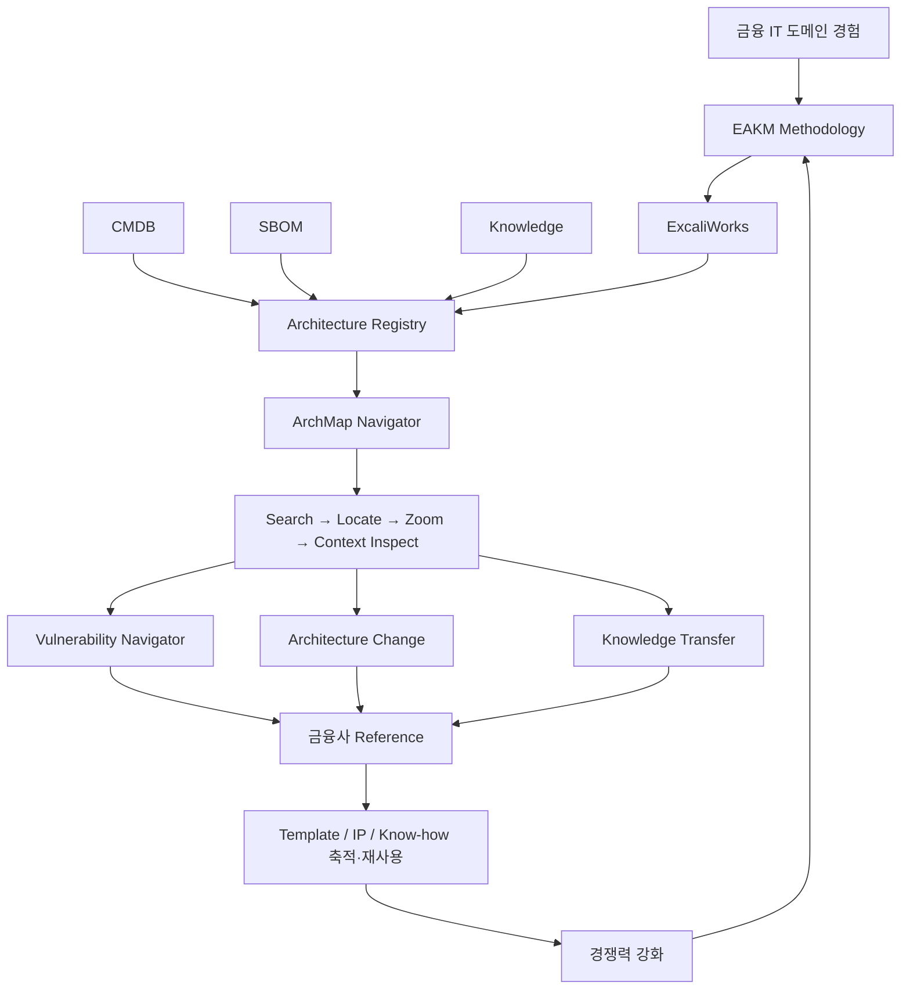
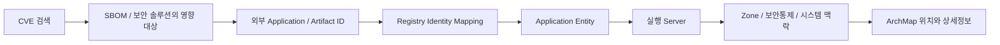
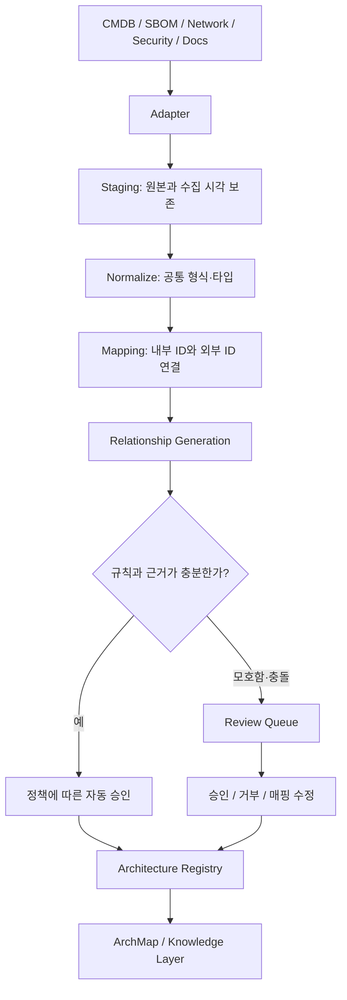

# ExcaliWorks / ArchMap 사업모델 및 아키텍처 요약

> **금융 IT 도메인 경험을 기반으로 기업의 기존 자산·보안·지식 데이터를 연결하고, 아키텍처 지도에서 검색·위치 확인·확대·맥락 탐색을 제공한다.**
>
> 아키텍트는 자유롭게 그린다. 기존 시스템이 아는 사실은 가져오고, 분석에 필요한 의미만 명시한다. Publish는 확정된 의미를 검증하고 Registry에 동기화한다.

이 노트는 확인 가능한 원 대화의 최근 설계 논의와 프로젝트의 `ExcaliWorks-Final-Moat.excalidraw` 내용을 종합한다. 사업 포지셔닝과 설계 방향은 논의 요약이며, 상세 스키마·가격 체계·단계별 로드맵은 이를 실행하기 위한 **제안**이다. 구현 완료, 고객 검증, 확정 매출 또는 확정 일정으로 해석하지 않는다. 원 대화 조회에서 더 오래된 턴은 제공되지 않아, 확인되지 않은 과거 합의는 단정하지 않았다.

## 목차

- [[#1. 사업 포지셔닝]]
- [[#2. 최종 Moat와 경쟁력의 선순환]]
- [[#3. 사용자 핵심 유스케이스 3개]]
- [[#4. 데이터 계층과 Architecture Registry의 역할]]
- [[#5. Entity와 Relationship 모델]]
- [[#6. PostgreSQL 구조]]
- [[#7. CMDB·SBOM·CVE 연계]]
- [[#8. Registry 자동화 파이프라인]]
- [[#9. Excalidraw와 Registry의 역할 분리]]
- [[#10. Draft와 Publish]]
- [[#11. Semantic Relationship의 모호성과 해결책]]
- [[#12. Vulnerability Navigator의 탐색 흐름]]
- [[#13. 1인기업 경쟁력과 수익모델]]
- [[#14. 실행 로드맵 제안]]
- [[#15. 설계 결정과 남은 검증 과제]]

## 1. 사업 포지셔닝

ExcaliWorks는 단순한 그림 편집기나 문서 보관함을 넘어, **아키텍처 지식과 기업 데이터를 연결하는 업무 도구**를 지향한다. ArchMap은 그 정보를 시각적 지도에서 탐색하는 사용자 접점이다.

- **주요 고객 가설:** 금융회사 및 복잡한 IT 자산·시스템 관계를 가진 기업.
- **주요 사용자:** 아키텍트, 보안 담당자, 운영 담당자, 변경 검토자, 업무 인수인계 담당자.
- **해결 문제:** CMDB, SBOM, 보안정보, 설계문서, 아키텍처 그림이 흩어져 있어 영향 범위와 설계 맥락을 연결하기 어렵다.
- **제공 가치:** 객체와 관계를 기준으로 데이터를 연결하고, 검색 결과를 실제 아키텍처 위치와 설명으로 이어준다.
- **도입 원칙:** 기존 CMDB·SBOM을 대체하기보다 연결한다. 그림을 그리는 기존 업무에는 최소한의 Semantic Layer를 추가한다.

차별화의 기준은 “문서를 어디에 저장하는가”보다 “어떤 자산과 시스템이 어떻게 연결되어 있으며, 필요한 맥락을 얼마나 빨리 찾는가”이다.

## 2. 최종 Moat와 경쟁력의 선순환

프로젝트의 최종 Moat 도식은 다음 흐름으로 정리된다.



**Moat의 핵심은 도메인 경험, 방법론, 고객 연계 자산, 현장 레퍼런스가 함께 축적되는 구조**다. Zoom 같은 단일 기능만으로 경쟁력을 설명하지 않는다.

| 축적 자산 | 다음 고객에서의 가치 |
|---|---|
| 금융 IT 도메인 경험 | 중요한 질문과 실제 업무 흐름을 구별 |
| EAKM 방법론 | 아키텍처와 지식을 연결하는 도입 절차의 반복 가능성 |
| Adapter·Mapping 규칙 | 고객별 데이터 차이를 흡수하고 구축 공수 절감 |
| Entity·Relationship 모델 | 탐색과 영향분석을 위한 공통 언어 |
| 아키텍처·지식 템플릿 | 주요 View와 설명 구조를 빠르게 구성 |
| 금융사 레퍼런스 | 효과를 보여주는 사례와 도입 신뢰 |
| IP·Know-how | 다음 프로젝트의 품질과 속도 향상 |

EAKM의 구체적인 정의·명칭 확장은 확인 가능한 자료에 없으므로 여기서는 방법론 이름으로 유지한다. 파이프라인과 템플릿은 기술/IP **후보**이며, 법적 독점권이나 입증된 진입장벽을 뜻하지 않는다.

## 3. 사용자 핵심 유스케이스 3개

### 3.1 Vulnerability Navigator — 취약점 영향 탐색

**질문:** “이 CVE에 영향을 받는 애플리케이션은 무엇이며, 어디에 배포되어 있고 어떤 시스템과 연결되는가?”

SBOM 또는 보안 솔루션이 제공하는 영향 대상 → Registry의 내부 Entity 매핑 → 서버·Zone·보안통제·아키텍처 View → 상세정보와 담당자 확인으로 이어진다.

산출물은 영향 대상 목록, 지도에서의 위치, 연관 시스템·보안통제·원본 근거다. 취약 컴포넌트가 있다는 사실과 실제 공격 가능성은 구별해야 한다.

### 3.2 Architecture Change — 변경 영향 검토

**질문:** “DB, 인증시스템, API 또는 서버를 변경하면 어떤 시스템과 설계 의존관계를 검토해야 하는가?”

`DEPENDS_ON`, `CALLS`, `RUNS_ON`, `PROTECTED_BY` 같은 관계를 탐색하고, 관련 지도와 설계 결정 문서를 확인한다. Draft/Publish의 의미정보 변경 내역은 검토와 추적에 사용한다.

관계 그래프는 검토 대상을 찾는 근거다. 실제 장애 전파나 변경 안전성을 자동으로 보증하는 것은 별도 검증 과제다.

### 3.3 Knowledge Transfer — 인수인계와 맥락 이해

**질문:** “이 시스템이 어디에 있고, 무엇과 연결되며, 왜 이렇게 설계되었고 누가 담당하는가?”

ArchMap에서 Entity를 선택해 Obsidian의 설명, ADR, 운영절차 및 외부 자산정보를 연결한다. 그림의 위치 정보와 문서의 설계 의도를 함께 제공한다.

## 4. 데이터 계층과 Architecture Registry의 역할

| 계층 | 관리 책임 | 연결 방식 |
|---|---|---|
| CMDB | CI·서버·자산의 운영 사실 | 외부 CI ID와 API 참조 |
| SBOM·보안 솔루션 | 컴포넌트·버전·CVE·영향 판정 | 애플리케이션·Artifact 참조 |
| Architecture Registry | Entity 식별, 의미관계, 외부 참조, 지도·문서 연결 | 안정적인 내부 Entity ID |
| Excalidraw / ArchMap | 위치·배치·색상·확대·시각적 탐색 | 도형과 Entity의 매핑 |
| Obsidian Markdown | 설명·설계 의도·ADR·운영 지식 | frontmatter의 Entity ID |

Registry는 **Thin Semantic Registry**, 즉 탐색과 분석에 필요한 **Semantic Skeleton**이다. 모든 CMDB 속성이나 SBOM 컴포넌트를 복제하지 않고, 필요한 식별정보·관계·참조 및 선택적인 조회용 캐시를 유지한다.

Registry는 승인된 아키텍처 의미정보의 공식 저장소다. IP·OS·버전 등 원본 사실의 책임은 해당 원천 시스템에 남는다. 전체 기업 데이터의 유일한 원본으로 Registry를 취급하지 않는다.

## 5. Entity와 Relationship 모델

### 5.1 Entity

Entity는 시스템, 애플리케이션, 서버, DB, 보안장비, Zone, 조직처럼 검색·분석·탐색할 대상을 뜻한다.

```text
SYS-001   SYSTEM        인터넷뱅킹
APP-001   APPLICATION   인터넷뱅킹 애플리케이션
SRV-001   SERVER        WAS01
DB-001    DATABASE      Oracle01
SEC-001   SECURITY      WAF01
ZONE-001  ZONE          DMZ
ORG-001   ORGANIZATION  디지털서비스부
```

이름이나 파일 경로를 정체성으로 사용하지 않는다. 이름을 바꾸거나 한 Entity가 여러 지도에 등장해도 내부 ID는 유지한다. 외부 ID는 원천 시스템 및 연결 인스턴스와 함께 매핑한다.

### 5.2 Relationship

관계는 방향이 있는 `source → relation_type → target`으로 저장한다. 역방향은 조회로 구하며 같은 사실을 양쪽에 중복 기록하지 않는다.

```text
SYS-001 DEPENDS_ON   SYS-010
SYS-001 CALLS        API-001
APP-001 RUNS_ON      SRV-001
SRV-001 CONNECTS_TO  DB-001
SRV-001 LOCATED_IN   ZONE-001
SYS-001 PROTECTED_BY SEC-001
SYS-001 OWNED_BY     ORG-001
```

초기 관계 사전은 6~8개 정도로 제한한다.

| 관계 | 의미 |
|---|---|
| `CONTAINS` | 구조적 포함 |
| `DEPENDS_ON` | 업무·설계상의 의존 |
| `CONNECTS_TO` | 기술적 연결 |
| `CALLS` | API 또는 서비스 호출 |
| `RUNS_ON` | 실행되는 호스트 |
| `LOCATED_IN` | 위치 또는 Zone 소속 |
| `PROTECTED_BY` | 보안통제에 의한 보호 |
| `OWNED_BY` | 담당 조직 또는 소유자 |

이전 예시의 `USES`, `OWNER`, `BELONGS_TO`, `DEPLOYED_ON`, `HAS_COMPONENT` 등은 도입 시 의미를 검토해 정식 사전으로 매핑하거나 확장한다. 서로 다른 의미를 편의상 하나로 합치지 않는다. Source/Target의 허용 타입과 방향도 사전에 정의해야 한다.

## 6. PostgreSQL 구조

PostgreSQL을 예정 저장소로 사용한다. 관계형 테이블로 Entity와 Edge를 관리하고, 필요하면 재귀 조회로 관계 경로를 탐색한다. 아래는 **구현 검토용 최소 스키마 제안**이다.

```sql
CREATE TABLE entities (
    entity_id text PRIMARY KEY,
    entity_type text NOT NULL,
    name text NOT NULL,
    status text NOT NULL DEFAULT 'ACTIVE',
    metadata jsonb NOT NULL DEFAULT '{}'::jsonb,
    updated_at timestamptz NOT NULL DEFAULT now()
);

CREATE TABLE external_references (
    reference_id bigint GENERATED ALWAYS AS IDENTITY PRIMARY KEY,
    entity_id text NOT NULL REFERENCES entities(entity_id),
    source_system text NOT NULL,
    source_instance text NOT NULL,
    external_id text NOT NULL,
    source_reference text,
    last_synced_at timestamptz,
    UNIQUE (source_system, source_instance, external_id)
);

CREATE TABLE relationships (
    relationship_id text PRIMARY KEY,
    source_entity_id text NOT NULL REFERENCES entities(entity_id),
    relation_type text NOT NULL,
    target_entity_id text NOT NULL REFERENCES entities(entity_id),
    provenance text NOT NULL
        CHECK (provenance IN ('Imported', 'Explicit', 'Inferred')),
    review_status text NOT NULL DEFAULT 'PENDING'
        CHECK (review_status IN ('PENDING', 'APPROVED', 'REJECTED')),
    source_system text,
    source_reference text,
    confidence numeric CHECK (confidence BETWEEN 0 AND 1),
    verified_by text,
    verified_at timestamptz,
    last_synced_at timestamptz,
    metadata jsonb NOT NULL DEFAULT '{}'::jsonb
);

CREATE INDEX relationships_outgoing
    ON relationships (source_entity_id, relation_type);
CREATE INDEX relationships_incoming
    ON relationships (target_entity_id, relation_type);

CREATE TABLE drawing_bindings (
    drawing_id text NOT NULL,
    element_id text NOT NULL,
    entity_id text NOT NULL REFERENCES entities(entity_id),
    published_revision text,
    PRIMARY KEY (drawing_id, element_id)
);
```

추가 설계 대상으로 `documents`, `drawing_relationship_bindings`, `review_queue`, `publish_revisions`, `sync_runs`, Staging 테이블을 검토한다. 실제 구현에서는 명명 규칙과 저장 범위를 통일한다.

같은 관계에 여러 근거가 있으면 Canonical Relationship과 Evidence를 별도 테이블로 나누는 방안을 검토한다. 단순한 중복 제거로 서로 다른 출처나 환경 정보를 잃지 않도록 한다. 고객·환경·시점의 경계, 감사 이력, 권한, 관계 타입의 외래키는 본격적인 설계에서 추가한다.

역방향 검색 예시:

```sql
SELECT source_entity_id
FROM relationships
WHERE target_entity_id = 'SRV-001'
  AND relation_type = 'RUNS_ON'
  AND review_status = 'APPROVED';
```

## 7. CMDB·SBOM·CVE 연계



- **CMDB:** CI ID, 자산명, 유형, 상태, 시스템·Zone·소유 조직 등 기존 사실을 가져온다.
- **SBOM:** 애플리케이션·Artifact와 컴포넌트 정보를 연결한다. 전체 복제 대신 외부 참조를 우선한다.
- **CVE·보안정보:** 외부 솔루션의 영향 판정과 근거를 연결하고, 내부 Entity 및 지도 위치로 확장한다.
- **API Gateway·APM·Network/Security:** 제공 데이터가 정확히 의미를 뒷받침하는 경우 호출·연결·보안통제 관계의 근거로 사용한다.

예를 들어 “DMZ에 있고 Tomcat 9를 사용하며 외부에 노출된 시스템”은 Zone 관계, 소프트웨어 정보, 외부 노출 정보를 조합해 찾는다. 단순 키워드 검색만으로 처리하지 않는다.

데이터가 없거나 오래된 경우에는 `미확인`과 마지막 동기화 시각을 표시한다. CVE와 컴포넌트 이름의 문자열 일치만으로 취약 여부를 확정하지 않는다. 버전·Artifact·배포 환경의 매핑과 원천 솔루션의 판단 근거가 필요하다.

## 8. Registry 자동화 파이프라인



| 단계 | 역할 |
|---|---|
| Adapter | 고객별 API·파일·스키마에서 수집 |
| Staging | 원본을 보존하고 실패·재처리 가능하게 구성 |
| Normalize | 타입·상태·명칭·날짜 형식을 내부 공통 모델로 변환 |
| Identity Mapping | 외부 CI/Application ID를 내부 Entity ID에 연결 |
| Relationship Mapping | 원천 관계를 정의된 의미관계로 변환 |
| Review | 중복 후보·불명확한 관계·충돌만 검토 |
| Sync | 승인된 변화 반영, 출처·시각·실행 내역 기록 |

```yaml
# 고객별 Mapping Configuration의 개념 예시
source: customer_cmdb
entity_mapping:
  external_id: CI_ID
  name: CI_NAME
  type_field: CI_TYPE
relationship_rules:
  - field: ZONE_ID
    relation: LOCATED_IN
  - field: OWNER_DEPT
    relation: OWNED_BY
```

자동화의 핵심은 사람이 수천 개의 행을 입력하는 것이 아니라 **Adapter와 Mapping 규칙을 구성하는 것**이다. 배치·API·이벤트 동기화는 원천 시스템에 맞춰 선택한다. 재실행 시 중복을 만들지 않는 처리, 삭제·폐기 정책, 충돌 해결이 필요하다.

대화에서 제시된 자동 70~80%, 반자동 10~20%, 직접 정의 약 10%는 **설계 목표 예시**이며 실측 통계가 아니다. 실제 비율은 원천 데이터의 품질과 식별자 연결 가능성으로 검증한다.

## 9. Excalidraw와 Registry의 역할 분리

Excalidraw는 자유로운 그림과 배치를, Registry는 승인된 의미정보를 담당한다. 제목·메모·범례·배경·일반 화살표까지 Entity나 Relationship으로 등록하지 않는다.

```json
{
  "customData": {
    "archmap": {
      "managed": true,
      "entityId": "SRV-001",
      "entityType": "SERVER"
    }
  }
}
```

이 메타데이터는 개념 예시다. `managed: true`인 도형은 Entity를 참조하고, 일반 도형은 자유로운 Visual Object로 남는다. 서버명, IP, OS, 버전을 그림에 다시 입력해 공식 사실로 관리하지 않는다.

Obsidian의 Entity 노트도 최소 식별정보를 둔다.

```yaml
---
entityId: SYS-001
type: system
name: 인터넷뱅킹
---
```

본문에는 설계 설명, `[[ADR-023]]`, 운영절차 같은 지식을 작성한다. 전체 관계를 frontmatter에 중복 기록하지 않는다. 작은 POC에서는 JSON/frontmatter로 시작할 수 있지만, 예정된 최종 저장소는 PostgreSQL이다.

기존 Entity는 검색해서 지도에 배치한다. 한 Entity가 여러 그림에 나타날 수 있으므로 `Entity ID ↔ Drawing ID + Element ID` 매핑을 별도로 관리한다.

## 10. Draft와 Publish

| 동작 | 그림 | Registry |
|---|---|---|
| 자동 저장·일반 Save | Draft 저장 | 의미정보 변경 없음 |
| 도형 이동·색상 변경 | 자유롭게 편집 | 의미 변화로 취급하지 않음 |
| Managed 객체·관계 편집 | Draft에 변경 유지 | Publish 전에는 확정하지 않음 |
| Architecture Publish | 관리 대상의 변경 검증 | 승인 가능한 의미 변경 동기화 |
| 외부 데이터 Sync | 조회 상태를 갱신할 수 있음 | 별도 수집 정책에 따라 갱신 |

```text
Draft 작성
  → Managed Entity / Relationship 추출
  → 마지막 Published Revision과 비교
  → ID·관계 타입·대상·중복·충돌 검증
  → 확정 가능한 변경과 검토 필요 변경 분리
  → Review Queue에서 필요한 항목 해결
  → 승인된 변경을 Registry에 반영
  → Published Revision과 감사 내역 기록
```

신규 Managed Entity는 바로 DB에 등록할 필요가 없다. Publish 때 `기존 Entity 연결 / 새 Entity 생성 / 관리 제외`를 선택할 수 있다.

**그림에서 도형을 지웠다고 기업 자산 자체를 삭제해서는 안 된다.** 지도 배치 제거와 Entity 폐기를 구별한다. Imported 자산의 폐기 상태는 원천 정책에 따르고, 수동 정의 객체는 별도 검토한다. 복제 시 동일 자산의 다른 표현인지 새 자산인지도 구분해야 한다.

Publish가 미해결 항목 때문에 전체를 막을지, 승인된 항목만 부분 반영할지는 아직 제품 정책으로 결정해야 한다. 부분 반영한다면 Published Revision이 실제 반영 범위를 정확히 기록해야 한다.

## 11. Semantic Relationship의 모호성과 해결책

### 11.1 문제: 선의 모양만으로 의미가 결정되지 않는다

`WAS01 → DB01`은 연결, 사용, 설계 의존 등 여러 의미로 해석될 수 있다. 같은 그림에서도 서버의 기술적 연결과 애플리케이션의 업무 의존은 서로 다른 관계다.

> **Visual Edge와 Semantic Relationship은 동일하지 않다. Publish는 일반 화살표의 의미를 자동 추론해 확정하는 기능이 아니다.**

### 11.2 세 종류를 구분한다

| 종류 | 의미 | Registry 처리 |
|---|---|---|
| Imported Relationship | CMDB·SBOM·API 등에서 가져온 관계 | 원천 의미와 매핑 정책을 검증해 반영 |
| Explicit Semantic Relationship | 사용자가 의미를 명시한 관계 | Publish 검증 후 반영 |
| Visual Connector | 시각적 설명을 위한 일반 선 | 의미관계로 등록하지 않음 |

Managed Entity와 Managed Relationship만 Publish 대상으로 삼는다. 일반 도형·선이 공존해야 Excalidraw의 자유도를 유지할 수 있다.

### 11.3 Relation Tool / Relation Mode

```text
[일반선] [CONNECTS] [CALLS] [DEPENDS] [PROTECTS]

CALLS 선택 → 여러 호출 관계를 연속해서 작성
일반선 선택 → 의미정보 없는 연결선 작성
```

선마다 팝업을 띄우는 대신, 먼저 선택한 Tool이 이후 작성하는 관계의 타입을 부여한다. Entity도 `[Server] [Application] [Database] [Zone] [Security]` 도구 또는 기존 Entity 검색으로 생성·배치한다.

### 11.4 Review Queue

```text
Architecture Review — 확인 필요 3건
1. WAS03: 내부 Entity 미연결
2. API01 → Auth: Managed 관계의 타입 누락
3. DB02: CMDB 매핑 후보가 2개

[기존 Entity 연결] [새로 생성] [의미 지정] [관리 제외]
```

Review Queue는 예외를 모아 사용자가 처리하는 비차단 Inbox다. 일반 Visual Connector의 타입이 없다는 이유로 검토를 요구하지 않는다. 검토 대상은 관리하려는 관계의 누락·충돌·추론 후보다.

### 11.5 Provenance: Imported / Explicit / Inferred

| 출처 | 생성 방식 | 확정 원칙 |
|---|---|---|
| `Imported` | 원천 시스템 + Adapter/Mapping | 원천 권위·최신성·관계 의미가 검증된 범위에서 자동화 |
| `Explicit` | 아키텍트가 Relation Tool 등으로 지정 | 작성자·시각·검증 이력 기록 |
| `Inferred` | AI 또는 Rule의 추론 | 후보로 저장하고 승인 후 분석에 사용 |

Imported라는 이유만으로 항상 가장 정확한 것은 아니다. 신뢰도는 데이터 품질, 갱신 시점, 원천 책임 범위에 따라 평가한다. AI는 `Guess → Suggest → Review` 역할을 맡으며, 추천을 곧바로 확정하지 않는다. 표시되는 confidence는 검증된 보정이 없다면 정확도 확률로 단정할 수 없다.

출처와 승인 상태는 별도 축이다. Inferred 관계가 승인되어도 추론 출처와 승인자 기록은 유지한다.

### 11.6 하나의 선과 복수 의미관계

```json
{
  "customData": {
    "archmap": {
      "managed": true,
      "relatedRelations": ["REL-001", "REL-002"]
    }
  }
}
```

한 선이 여러 관계를 참조하는 모델도 가능하다. 단, 선의 시각적 끝점과 각 관계의 실제 Entity 끝점을 별도로 보여줘야 한다. 초기 POC는 관계 하나를 명시적으로 연결하는 방식부터 시작하고 복수 참조는 후속 확장으로 둔다.

## 12. Vulnerability Navigator의 탐색 흐름

```text
Search → Locate → Zoom → Inspect
검색      위치 확인   확대     맥락 확인
```

1. **Search:** CVE, 컴포넌트, 시스템, 서버 또는 조건으로 검색한다. 원천 판정·조건 조합으로 영향 Entity 집합을 얻는다.
2. **Locate:** Entity ID에 연결된 Drawing과 Element를 찾는다. 여러 View가 있으면 선택하고, 지도에 없으면 목록 결과와 미배치 상태를 표시한다.
3. **Zoom:** 대상 또는 관련 객체군으로 화면을 이동하고 확대·강조한다.
4. **Inspect:** CVE 근거, 컴포넌트·버전, 서버·Zone, 연관 시스템, 보안통제, 담당 조직, 설계 노트, 데이터 출처와 갱신 시각을 확인한다.

검색 결과를 그림에서 찾는 데서 끝나지 않고, 사용자가 영향과 대응 맥락을 판단할 수 있도록 원본 자료까지 이어주는 것이 가치다.

## 13. 1인기업 경쟁력과 수익모델

### 13.1 1인기업에 맞는 구축 방식

대규모 자산을 고객마다 손으로 등록하는 구조는 지속하기 어렵다. 고객 도입 작업을 **Data Entry에서 Mapping/Modeling으로 바꾸는 것**이 핵심이다.

```text
CMDB·SBOM 분석
  → Adapter 설정
  → Schema / Identity / Relationship Mapping
  → 중요한 Architecture 의미 보완
  → 핵심 View 구성
  → 교육·운영 인계
```

고객별 차이는 설정으로 흡수하고 공통 파이프라인·검토 UX·템플릿을 재사용한다. 원 대화의 Adapter 작업일, 고객 증가에 따른 신규 개발 비율 감소 등은 공수 목표 예시이며 보장된 생산성 수치가 아니다.

금융 IT 도메인 이해와 제품을 결합하는 **Consulting Product**가 방향이다. 단, 고객마다 다른 기능을 무제한 개발하면 재사용성과 1인 운영 능력이 약해진다. 지원 원천, 첫 유스케이스, 데이터 범위를 좁혀 반복 가능한 도입 패키지를 만든다.

### 13.2 수익모델 구성 제안

확인 가능한 대화에는 확정 가격·계약 조건이 없다. 다음은 논의 방향을 구체화한 제안이다.

| 수익 항목 | 제공 범위 | 사업상 역할 |
|---|---|---|
| 유료 진단·POC | 데이터 연결 가능성, 핵심 탐색 흐름 검증 | 구매 가치와 구축 난이도 확인 |
| 초기 구축·연계 비용 | Adapter, Mapping, 주요 View, 교육 | 고객별 도입 공수 회수 |
| 연간 라이선스·유지보수 | 제품 사용, 업데이트, 정해진 지원 | 반복 매출 기반 |
| 고급 모듈·연계 확장 | Vulnerability, Change, 추가 Adapter | 사용 가치에 따른 확장 |
| 방법론·템플릿·교육 | 아키텍처 지식 정리, 도입 가이드 | 도메인 자산의 제품화 |

가격은 사용자·조직·환경·모듈 중 관리 가능한 기준을 선택해 검증한다. 1인기업에서는 매출뿐 아니라 고객당 구축일, 월 지원시간, 커스텀 개발량을 함께 관리해야 한다. 고객 데이터와 고객별 비공개 규칙의 재사용은 계약과 권한 범위 안에서 다룬다.

## 14. 실행 로드맵 제안

확정 날짜 대신 단계별 완료 조건을 둔다.

| 단계 | 범위 | 다음 단계 진입 조건 |
|---|---|---|
| 1. 탐색 POC | 소규모 Entity, 지도 매핑, Search→Locate→Zoom→Inspect | 기존 방식보다 대상과 맥락을 빨리 찾음 |
| 2. Thin Registry | PostgreSQL, 외부 참조, 관계 사전, 최소 Adapter | 재수집해도 ID·매핑·관계가 안정적 |
| 3. 편집·검토 UX | Managed 도구, Draft/Publish, Review Queue, provenance | 잦은 그림 편집에도 등록 부담이 작음 |
| 4. 유료 고객 파일럿 | 하나의 핵심 유스케이스, 제한된 실제 데이터 | 효과·구축 공수·지원 비용·지불 의사 확인 |
| 5. 반복 가능한 상품 | 재사용 Adapter·Mapping·템플릿·도입 문서 | 다음 고객의 도입 공수가 줄어듦 |
| 6. 검증된 확장 | Change·Knowledge Transfer, 추가 데이터 연계 | 실제 수요와 운영 여력으로 우선순위 결정 |

세 유스케이스를 동시에 완성하기보다, 구매 이유가 명확하고 데이터 연결이 가능한 하나를 먼저 검증한다. Vulnerability Navigator는 구체적인 시작 후보지만 고객 환경에 맞춰 선택한다.

**측정 지표:** 질문 해결 시간, Entity 매핑 성공률, Review Queue 발생률, 정보 최신성, 고객당 구축 공수, 재사용 비율, 월 지원시간, 유료 전환 및 갱신 의사.

## 15. 설계 결정과 남은 검증 과제

### 유지할 방향

- 관계의 공식 저장소는 PostgreSQL 기반 Architecture Registry다.
- CMDB·SBOM의 사실은 외부 참조와 자동 수집으로 활용한다.
- Excalidraw는 시각적 표현, Obsidian은 설명과 설계 지식에 집중한다.
- 모든 도형·선을 구조화하지 않고 탐색·분석에 가치 있는 의미만 관리한다.
- Save와 Publish를 분리한다. 그림 편집은 Registry의 즉시 변경을 요구하지 않는다.
- Publish는 명시되거나 가져온 의미를 검증·동기화한다.
- Relation Tool과 Review Queue로 반복 팝업을 줄인다.
- Imported / Explicit / Inferred와 승인 상태를 분리해 추적한다.
- 고객 연계 자산·방법론·레퍼런스의 축적을 장기 경쟁력으로 삼는다.

### 후속 검증

- 실제 CMDB·SBOM 간 식별자 연결 품질과 데이터 접근 방식.
- 관계 사전의 정확한 의미·방향·허용 Entity 타입.
- 원천 Sync와 수동 의미정보가 충돌할 때의 우선순위.
- Publish의 부분 반영·동시 편집·복제·삭제·되돌리기 정책.
- 지도 밖 Entity 및 여러 Drawing에 등장하는 Entity의 탐색 UX.
- 권한·감사·고객 환경 배포 및 지원 범위.
- 고객이 비용을 지불할 질문, 가격 기준, 실제 반복 운영 비용.

> **사업의 실행 기준:** 아키텍처를 다시 입력하게 만들지 않고, 이미 존재하는 데이터와 이미 그리는 업무를 연결한다. 고객에게는 더 빠른 탐색과 검토를, 사업에는 반복 가능한 도입과 재사용 자산을 남긴다.
