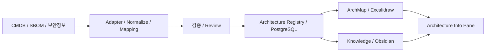

# ExcaliWorks / ArchMap 기술구조 기준선

갱신일: 2026-10-21 / 구현 전 설계 기록

사용자가 기존 기술구조를 정리·커밋하도록 요청한 데 따라 복원한 기준선이다. 과거 요약의 ‘유지할 방향’과 확인 가능한 수정 논의를 중심으로 정리했다. 모든 세부안의 최종 승인이나 구현 완료를 뜻하지 않는다. 근거 범위는 [출처 기록](../05_sources/2026-10-21-cross-chat-sources.md)에 남긴다.

## 구성과 책임

| 구성 | 책임 |
|---|---|
| ArchMap / Excalidraw | 시각 표현·지도 탐색·대상 강조·확대 |
| Obsidian / Markdown | 업무 지식·설계 설명·ADR·운영절차 |
| PostgreSQL Architecture Registry | Entity·의미관계·외부 ID·Drawing/문서 연결·Publish 이력 |
| CMDB | 자산과 운영 사실의 원천 |
| SBOM·보안 솔루션 | 컴포넌트·버전·CVE 영향 판정 및 근거의 원천 |
| Adapter / Mapping | 고객별 원천 형식과 식별자를 내부 모델에 연결 |
| Info Pane | 선택한 Entity의 구조·보안·지식·출처 맥락 확인 |

Registry는 탐색·분석에 필요한 **Thin Semantic Registry**다. CMDB와 SBOM을 모두 복제하지 않는다. 원천 사실의 책임은 각 시스템에 두고, Registry는 승인된 의미관계와 연결정보를 관리한다.

## Entity와 시각 요소의 분리
- 시스템·애플리케이션·서버·DB·Zone 등에 안정적인 내부 Entity ID를 부여한다.
- 외부 ID는 원천 시스템·인스턴스와 함께 매핑한다. 이름이나 IP만으로 동일성을 확정하지 않는다.
- 같은 Entity가 여러 Drawing에 등장할 수 있다. Entity ID와 Drawing ID·Element ID의 연결을 관리한다.
- 의미관계는 source → type → target으로 표현하고 출처와 승인 상태를 구분한다.
- Managed Entity/Relationship과 일반 Visual Object/Connector를 공존시킨다. 일반 선은 자동으로 의미관계가 되지 않는다.

관계 타입 후보는 CONTAINS, DEPENDS_ON, CONNECTS_TO, CALLS, RUNS_ON, LOCATED_IN, PROTECTED_BY, OWNED_BY다. 정확한 사전·방향·허용 타입과 테이블 정의는 상세 설계 대상으로 남긴다. 과거 SQL은 예시이며 확정 스키마가 아니다.

## 수집과 동기화
**Adapter → Staging → Normalize → Identity/Relationship Mapping → Review → Registry**.

원천 데이터에서 가져올 수 있는 사실·관계를 활용하고, 사람이 입력해야 하는 설계 의미만 보완한다. 모호한 매핑·중복·충돌은 Review Queue로 보낸다. 출처·수집 시각·승인 이력을 추적한다. 자동화 비율이나 구축 공수의 과거 숫자는 목표 예시이며 실측 성과가 아니다.

## Draft와 Semantic Publish
초기 구상은 ‘그리면 Publish가 의미를 알아서 추론한다’였으나, 사용자가 관계의 복수 의미와 반복 팝업을 지적하면서 수정되었다.

1. 일반 Save는 Drawing Draft를 저장한다.
2. Relation Tool/Mode 등으로 관리할 관계의 의미를 명시하거나 원천에서 가져온다.
3. Publish는 마지막 Published Revision 대비 Managed 요소의 의미 변경을 검증한다.
4. ID·대상·타입·중복·매핑을 검사하고 승인 가능한 의미정보를 Registry에 동기화한다.
5. 모호한 항목은 비차단 Review Queue에서 처리한다. AI 추천은 승인 전까지 후보로 유지한다.

도형 이동·색상 변경은 의미 변경과 구분한다. 한 선과 한 의미관계의 일대일 대응을 강제하지 않되, 복수 관계 참조 UX는 후속 설계다. Drawing에서 도형을 지운 것이 전역 Entity 삭제를 뜻하는지도 별도 정책으로 정해야 한다.

Imported / Explicit / Inferred는 **출처**이며 승인 여부와 별도다. Imported도 원천 품질과 최신성 검토가 필요하다.

## 취약점 영향 탐색
CVE → SBOM/보안 솔루션의 영향 컴포넌트·버전 → Application/Artifact → CMDB 배포 서버 → Registry의 Zone·시스템·관계 → ArchMap 위치·강조 → Info Pane의 근거·담당자·절차.

버전·배포 연결과 원천 판정 근거를 사용한다. 데이터 미확인·오래됨은 표시한다. 영향 후보 탐색과 실제 악용 가능성 판정은 구별한다. 지도에 없는 Entity는 목록과 미배치 상태로 다룬다.

## 지식과 설계 근거
Entity와 Obsidian 노트·ADR·운영절차를 연결한다. 후속 대화의 ‘DMZ가 왜 분리됐는가’ 예시는 설계 결정·대안·요구사항을 탐색하려는 요구다. ADR 링크만 넣을지, 별도 관계·문서 모델로 관리할지는 미확정이며 해당 대화의 구체 응답은 조회되지 않았다.

## Git과 제품 Publish
이 사업 기획 저장소는 **GitHub**다. 과거 자료의 GitLab은 고객 환경에서 Vault·Drawing 파일을 버전 관리하는 운용 제안이다. GitLab 사용을 제품 필수조건으로 확정하지 않는다.

파일 커밋·병합과 Architecture Publish는 서로 다른 사건이다. 파일 Revision과 Publish Revision의 연결 방식, DB 백업·감사·복구는 상세 설계가 필요하다.

## 남은 설계 과제
- 원천 Sync와 수동 편집 충돌, 폐기·삭제·되돌리기 정책.
- Publish 전체/부분 반영, 동시 편집, Revision 연결.
- 관계 사전·정체성 매핑·문서/ADR 연결 모델.
- 금융사 배포·권한·감사·데이터 접근과 지원 범위.
- 실제 CMDB·SBOM 데이터로 연계 품질과 사용자 부담 검증.

## 사용자 접점 구체화 (2026-10-22)

[DEC-004](../03_decisions/DEC-004-obsidian-navigation-and-device-popup.md)에 따라 고객 화면은 Obsidian·Excalidraw 중심으로 구성하며 별도 웹사이트 상품을 만들지 않는다. 장비 선택 시 관련 정보는 팝업/미리보기로 확인하는 방향이다. 위 Info Pane은 정보 제공 책임을 표현한 것으로 상시 우측 패널을 의무화하지 않는다. 팝업의 구체 동작과 기본 기능/추가 개발 경계는 미검증이다. 기존 Registry·Adapter 설계 기준선은 유지한다.
